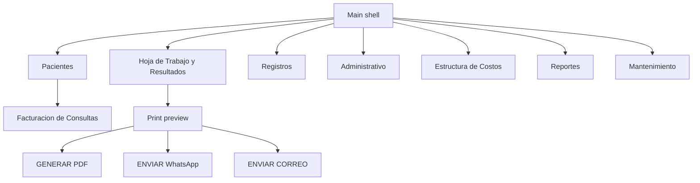

# Complete the SICOEXC context from the live session

The attached files are a Windows session of **Menú Principal del Sistema de Control de Exámenes Clínicos (SICOEXC)** on 30/10/2026, plus a BIOMEG result preview. They replace several “not published” statements in [docs/sicoexc-research.md](docs/sicoexc-research.md). This work updates that documentation. It does not build a new application.

Sources, kept outside the repo because the print preview contains a real patient:

- [captures/home.PNG](/Users/optec-123/Downloads/captures/home.PNG) and [captures/print.PNG](/Users/optec-123/Downloads/captures/print.PNG)
- [screenshots.pptx](/Users/optec-123/Downloads/screenshots.pptx), 15 screen images (slides 1–15). **Ayuda** is never opened. Several report submenus stay collapsed.

Patient name, cédula, and telephone from the print preview will not be copied into the docs. Laboratory identity (BIOMEG, RIF) and field labels will.

## What the session actually shows

Confirmed on the shell: active user **LCDA. GIULIANA**, **Tasa BCV 889,26**, **QR: ACTIVO**, **Precio Sabado: INACTIVO**, a banner that version **10** is available and that equipment transmission is available, a home **Nueva Observación** panel filtered by date, and a poster for **LIS bidireccional** (Mindray BC-20 and a chemistry analyzer; exact second and third model names will be transcribed from the pixels, not guessed). Windows taskbar shows WhatsApp installed on the same PC.

Toolbar: Ingreso Particular, Ingreso Empresa, Hoja de Trabajo, Cargar Resultados, Presupuesto, Cierre Caja, Clave, Cerrar Sesión, Salir.

Menus now known, which the dossier said were not published:

- **Pacientes:** Ingreso Particular / Empresa, Facturar Consulta, Modificar Pacientes, Trasladar Paciente.
- **Hoja de Trabajo y Resultados:** Hoja de Trabajo, Cargar Resultados, Imprimir por Paciente, Imprimir Prueba Individual, Status de Impresión, Imprimir Referidos.
- **Registros:** Médicos, Empresas, Proveedores, Reactivos y Servicios, Equipos, Parásitos, Antibióticos, Microorganismos, Muestras de Bacteriología, Observaciones de Bacteriología.
- **Administrativo:** reprints of delivery orders, company orders, invoices, retentions, credit and debit notes; notes themselves; reverse a relación; abonos; pagos; cierre de caja; cierre mensual; presupuesto; relación de pacientes; cuentas por cobrar and por pagar; retenciones ISLR; órdenes de compra; recibir inventario.
- **Estructura de Costos:** promedios paciente/pruebas, insumos, salarios, costos/reactivos, and three cost lists.
- **Reportes:** patients, prices, doctors, suppliers, reagents, inventory, patients by date, companies, sales (resumen, detalle, libro de ventas, IGTF, ventas por cajero, ventas por empresa), purchases (libro and órdenes), retentions (ARCV, XML ISLR, IVA), payments, cuentas por pagar (general and por pagar), cuentas por cobrar, equipment, budgets, evolución de pacientes, estadísticas. A few of these still have an unopened arrow.
- **Mantenimiento:** aumento general, precio exámenes, modificar valores, copiar perfiles, nota de bacteriología, QR, precio sábado, respaldo de correo, nuevo usuario, respaldo de la BD, auditoría.

**Facturación de Consultas** is the admission screen. It has factura and control numbers; cost types Rutina, Seguro/Empresa, Emergencia, Hospitalizado; patient cédula, name, birth date, age, sex, phone, email, motivo, médico; billing cédula, razón social, dirección; an exam picker; payment lines for discount, efectivo USD and Bs, Zelle, débito, pago móvil, transferencia, crédito, banco, and referencia; totals for exempt, taxable base, IVA, IGTF, USD, Bs, abono, and resta. Birth date is prefilled **02/10/2012** on a blank form.

**Lista de Precios** columns: PARTICULAR, ALIADOS, HOSPITALIZADO, EMERGENCIA, ESTATAL, plus Disponible / No Disponible. Chemistry is one category filter.

**Print preview** actions are GENERAR PDF, ENVIAR WhatsApp, ENVIAR CORREO, SALIR. The BIOMEG report shows a QR, RIF, convenio as a **company name** (not only the word Ambulatoria), order `0001`, sample and report dates, and out-of-range results in red. An empty **QUIMICA SANGUINEA** header still prints.

## Corrections this forces

These current statements are now wrong or incomplete and must be revised in place:

- [docs/sicoexc-research.md](docs/sicoexc-research.md) section 6 says application navigation is not published. Section 5 treats version 9.0 as the only named release. The running program advertises version 10.
- [docs/architecture/desktop-client.md](docs/architecture/desktop-client.md) and [docs/architecture/observed-runtime.md](docs/architecture/observed-runtime.md) can now cite a real Windows shell, BCV rate, QR flag, and Saturday-price flag.
- [docs/modules/README.md](docs/modules/README.md) is missing whole areas the menus name: inventory and purchases, microbiology catalogs, cost structure, retentions, credit/debit notes, budgets, referrals, and patient evolution.
- [docs/data-model/patient.md](docs/data-model/patient.md), [docs/data-model/order.md](docs/data-model/order.md), and [docs/data-model/convenio.md](docs/data-model/convenio.md) missed birth date, email, motivo, médico, razón social, dirección, and convenio-as-company. [docs/data-model/records-not-on-the-report.md](docs/data-model/records-not-on-the-report.md) said invoice fields and QR were unseen; the invoice form and the preview show both.
- [docs/workflow/01-admit-and-bill.md](docs/workflow/01-admit-and-bill.md) through [docs/workflow/07-deliver.md](docs/workflow/07-deliver.md) can be tied to named commands instead of inferred steps. Delivery is three explicit buttons, not an unknown trigger.

## How the files will be written

New folder [docs/session/](docs/session/) as the primary source, then short corrections in the existing files so they point at it instead of repeating a second menu bible.

- `docs/session/README.md` — session facts, what was not opened, privacy rule.
- One walkthrough per menu plus `facturacion.md`, `lista-de-precios.md`, and `print-preview.md`. Each command gets: where it sits, what the screen shows if it was opened, which earlier module it replaces or extends, and the edge case if one is visible.
- `docs/session/gaps-and-edge-cases.md` — only issues visible in this session: default birth date, global QR and Saturday-price switches, empty section headers, red abnormal values with no separate flag column, two entry paths (particular vs empresa), payment methods beyond Cashea, IGTF, reprints versus originals, version-10 banner versus the public version-9.0 page, and submenus still collapsed.
- Update the research dossier navigation and version paragraphs, the module index, the data-model entities the form now proves, and the workflow steps so each step names the real command. Leave inferred SQL column names inferred. Menu labels are not column names.
